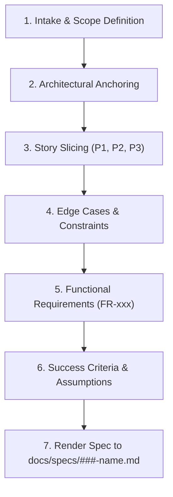

# Feature Specification Skill (Spec-Driven Development)

This skill establishes the formal procedure for eliciting, structuring, and producing standardized Feature Specifications (`spec.md`) prior to code implementation.

---

## 1. Core Principles of Spec-Driven Slicing

1. **Prioritized User Journeys (P1, P2, P3)**:
   - **P1 (MVP Slice)**: The most critical, foundational path. If only P1 is implemented, the system must still deliver a functional, standalone slice of value.
   - **P2, P3, ...**: Subsequent enhancements, alternate paths, administration controls, or secondary workflows.
2. **Independent Testability**:
   - Each story MUST be independently testable, deployable, and demonstrable without requiring subsequent stories to be implemented.
3. **Strict Acceptance Criteria (Gherkin)**:
   - Scenarios must be formulated with explicit **Given** (precondition), **When** (action/event), **Then** (observable outcome).
4. **RFC 2119 Requirements**:
   - Use standard normative verbs: `MUST`, `MUST NOT`, `SHOULD`, `MAY`.
   - Ambiguities must be explicitly flagged with `[NEEDS CLARIFICATION: reason]`.

---

## 2. Step-by-Step Process for Drafting a Feature Spec

### Step 1: Intake & Naming
1. Capture the raw user description or prompt into `$ARGUMENTS`.
2. Assign a sequential feature ID and kebab-case name: `###-feature-name` (e.g., `001-order-cancellation-stock-restoration`).
3. Set the target branch name: `[###-feature-name]`.
4. Set status to `Draft` and date to current ISO date (`YYYY-MM-DD`).

### Step 2: Architectural Anchoring
Before writing the spec, verify alignment with the codebase and architecture:
- Review `docs/objetivo-do-sistema.md` for business flows and permissions.
- Review `docs/arquitetura-do-sistema.md` for domain constraints, transaction boundaries, and entities.
- Verify module READMEs in `src/main/java/br/com/ecommerce/*/README.md` to identify affected packages and dependencies.

### Step 3: Prioritized User Stories Slicing
For each story:
- Define title and assign priority (`P1`, `P2`, `P3`).
- Write plain language description of the user journey.
- Fill **Why this priority** (business justification and impact).
- Fill **Independent Test** (how to verify this story in isolation).
- Write at least 2 acceptance scenarios in Gherkin (**Given** / **When** / **Then**).

### Step 4: Edge Cases Identification
Document boundary conditions and failure modes:
- Concurrency and race conditions (e.g., two users acting simultaneously).
- Boundary states and transitions (e.g., transitions at the edge of cancellation eligibility).
- Data validation and missing headers (e.g., missing idempotency keys, null bodies).
- Network and transaction failures (e.g., rollback scenarios).

### Step 5: Functional Requirements & Key Entities
1. Write specific, verifiable functional requirements (**FR-001**, **FR-002**, etc.).
2. Detail domain entities involved in a technology-agnostic manner (key attributes, behaviors, invariants).

### Step 6: Measurable Success Criteria & Assumptions
1. Write quantifiable success criteria (**SC-001**, **SC-002**, etc.) without leaking technical implementation details.
2. Explicitly document all assumptions, scope boundaries, and environment defaults.

### Step 7: Artifact Generation
1. Use the template provided in [resources/template.md](./resources/template.md).
2. Save the completed specification under:
   `docs/specs/[###-feature-name].md`
3. Link the generated specification in conversation for user review.

---

## 3. Template Reference

The reference template is stored at:
[template.md](./resources/template.md)
