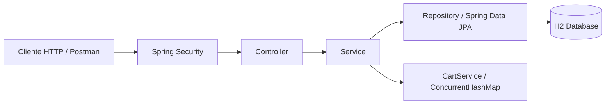

# API E-Commerce — Java e Spring Boot

API RESTful de e-commerce implementada em **Java 21**, **Spring Boot 3.5.6**, **Spring Data JPA**, **Spring Security** e **H2 Database**. O projeto contempla autenticação, usuários, catálogo, categorias, carrinho, pedidos, estoque e pagamentos.

O desenvolvimento contou com o auxílio do **Google Antigravity**, como ferramenta de inteligência artificial, seguindo práticas de **Spec-Driven Development (SDD)**, com especificações, instruções para agentes e validação por testes.

> **Execução exclusivamente local, sem Docker.** Não é necessário instalar PostgreSQL ou Redis. Docker, Docker Compose e Testcontainers não devem ser utilizados nesta variante.

## Pré-requisitos

- JDK 21 (LTS).
- Apache Maven 3.9+ (recomendado pelo guia do projeto).
- IntelliJ IDEA ou outra IDE Java (opcional).
- Postman (opcional) ou Node.js 20+ e npm 10+ para executar Newman no host. Node.js não é necessário para executar a API.

## Configuração

### 1. Instalar dependências e compilar

Na raiz do projeto, onde está o `pom.xml`:

```bash
java -version
mvn -version
mvn clean compile
```

### 2. Variáveis de ambiente

O arquivo `src/main/resources/application.yml` contém a configuração padrão. Não é necessário criar um `.env`.

| Variável | Padrão | Finalidade |
|---|---|---|
| `PORT` | `8080` | Porta HTTP |
| `JWT_SECRET` | Chave de desenvolvimento definida no YAML | Assinatura JWT HS256 |

Exemplo opcional no PowerShell:

```powershell
$env:PORT = "8080"
$env:JWT_SECRET = "substitua-por-uma-chave-local-com-pelo-menos-32-bytes"
```

### 3. Banco de dados H2

| Propriedade | Valor |
|---|---|
| URL JDBC | `jdbc:h2:file:./data/ecommerce;DB_CLOSE_ON_EXIT=FALSE` |
| Usuário | `sa` |
| Senha | Vazia |
| Driver | `org.h2.Driver` |
| Hibernate DDL | `update` |
| Inicialização SQL | `classpath:seed-data.sql` |
| Console | `http://localhost:8080/h2-console` |

O Hibernate atualiza o esquema e o script SQL é executado na inicialização. Não há migrações Prisma ou Flyway configuradas.

**Atenção:** embora o H2 utilize o arquivo `data/ecommerce.mv.db`, o script `seed-data.sql` contém comandos `DELETE` e repovoa as tabelas a cada inicialização. Portanto, os dados de negócio não são preservados entre reinicializações na configuração atual. Não utilize dados reais neste ambiente.

## Rodando a API

### Terminal

```bash
mvn spring-boot:run
```

### IntelliJ IDEA

1. Abra o projeto Maven pelo `pom.xml`.
2. Configure o Project SDK para Java 21.
3. Recarregue as dependências Maven.
4. Execute a classe `br.com.ecommerce.EcommerceApplication`.
5. Mantenha o diretório de trabalho na raiz do projeto.

URL base: `http://localhost:8080/api/v1`.

Para verificar se a API está respondendo:

```bash
curl http://localhost:8080/api/v1/products
curl http://localhost:8080/api/v1/categories
```

Não há dependência Spring Boot Actuator nem endpoint de health check implementado no código analisado. A liberação de `/actuator/health` na segurança não cria esse endpoint.

Para encerrar, use `Ctrl+C` no terminal ou Stop na IDE. Se ocorrer bloqueio do H2, encerre a instância anterior da aplicação e feche conexões externas ao arquivo antes de reiniciar. Não apague o banco como primeira medida.

## Estrutura do projeto

```text
.
├── .agents/skills/feature-spec/     # Skill de especificação e template
├── AGENTS.md                       # Diretrizes para agentes de IA
├── docs/
│   ├── AMBIENTE_LOCAL.md
│   ├── arquitetura-do-sistema.md
│   ├── objetivo-do-sistema.md
│   └── specs/
│       └── 001-order-cancellation-stock-restoration.md
├── postman/
│   ├── ecommerce-local.postman_environment.json
│   └── order-cancellation.postman_collection.json
├── src/
│   ├── main/
│   │   ├── java/br/com/ecommerce/
│   │   │   ├── EcommerceApplication.java
│   │   │   ├── config/              # Segurança e tratamento de erros
│   │   │   ├── controller/          # Endpoints REST
│   │   │   ├── service/             # Regras de negócio
│   │   │   ├── repository/          # Acesso a dados via JPA
│   │   │   └── model/               # Entidades e enums
│   │   ├── Prompts/                 # Prompts do desenvolvimento assistido
│   │   └── resources/
│   │       ├── application.yml
│   │       └── seed-data.sql
│   └── test/
│       ├── java/br/com/ecommerce/
│       └── resources/
├── data/                            # Arquivos locais do H2
├── README-SEM-DOCKER.md
├── README.md
└── pom.xml
```

## Endpoints

Os caminhos abaixo utilizam o prefixo `/api/v1`, salvo indicação explícita.

| Método | Caminho | Acesso |
|---|---|---|
| POST | `/auth/register` | Público |
| POST | `/auth/login` | Público |
| GET, PUT, DELETE | `/users/{id}` | Titular ou ADMIN |
| GET | `/categories`, `/categories/{id}` | Público |
| POST | `/categories` | ADMIN |
| PUT, DELETE | `/categories/{id}` | ADMIN |
| GET | `/products`, `/products/{id}` | Público |
| POST | `/products` | ADMIN |
| PUT, DELETE | `/products/{id}` | ADMIN |
| GET | `/cart` | Autenticado |
| POST | `/cart/items` | Autenticado |
| DELETE | `/cart/items/{itemId}` | Autenticado |
| GET, POST | `/orders` | Autenticado |
| DELETE | `/orders/{id}` | Titular ou ADMIN |
| POST | `/payments` | Titular do pedido |
| POST | `/payments/{id}/confirm` | Titular do pedido |
| POST | `/payments/{id}/cancel` | Titular do pedido |

O `OrderController` também aceita os caminhos completos `/order`, `/orders` e `/api/v1/order` como aliases de `/api/v1/orders`.

### Cancelamento de pedidos e restauração de estoque

Endpoint principal: `DELETE /order/{id}` (também disponível em `DELETE /api/v1/orders/{id}`). O antigo `POST /order/{id}/cancel` não está mapeado.

- O cancelamento é lógico: altera o status para `CANCELED`, sem excluir o pedido.
- Restaura as quantidades dos produtos ao estoque dentro de uma transação.
- Repetir o cancelamento de um pedido já cancelado não restaura o estoque novamente.
- Pedidos `SHIPPED` ou `DELIVERED` não podem ser cancelados.

| HTTP | Resultado esperado |
|---|---|
| 200 | Cancelamento realizado ou pedido já cancelado |
| 400 | Pedido enviado ou entregue |
| 401 | Token ausente ou inválido |
| 403 | Usuário sem autorização |
| 404 | Pedido inexistente |

## Autenticação

A API utiliza JWT com Spring Security, sessão stateless, assinatura HS256 e BCrypt para senhas. Login e registro retornam `data.tokens.accessToken` e `data.tokens.refreshToken`.

- Access token: 15 minutos.
- Refresh token: 7 dias; não existe endpoint de renovação nem persistência de refresh tokens.
- Papéis: `USER` e `ADMIN`.

Endpoints protegidos requerem:

```http
Authorization: Bearer <access_token>
```

Exemplo de login (`POST /api/v1/auth/login`):

```json
{
  "email": "titular@teste.com",
  "password": "123456"
}
```

Usuários de demonstração definidos no seed: `titular@teste.com`, `outro@teste.com` e `admin@teste.com`. A senha de demonstração indicada pelo script é `123456` (não validada por execução nesta revisão).

## Fluxo principal — compra completa

1. `POST /api/v1/auth/register` — criar conta.
2. `POST /api/v1/auth/login` — obter token.
3. `GET /api/v1/products` — consultar catálogo.
4. `POST /api/v1/cart/items` — adicionar produto (`productId`, `quantity`).
5. `POST /api/v1/orders` — checkout, baixa de estoque e limpeza do carrinho.
6. `POST /api/v1/payments` — criar pagamento com `orderId`.
7. `POST /api/v1/payments/{id}/confirm` — confirmar pagamento com header `Idempotency-Key` não vazio.

O identificador usado na confirmação é o do pagamento, não o do pedido. O pagamento é representado por mudanças de estado internas; não há gateway externo configurado.

## Arquitetura



A aplicação é organizada em camadas, em um único projeto Maven. Controllers recebem requisições; services concentram regras de negócio; repositories acessam as entidades persistidas; config reúne segurança e tratamento de erros. O carrinho é armazenado em memória e perdido quando a aplicação é encerrada.

## Desenvolvimento assistido por IA — Antigravity e SDD

O Antigravity foi utilizado como ferramenta de IA no desenvolvimento, conforme informado pelo responsável pelo projeto. Os artefatos existentes no repositório apoiam o fluxo de Spec-Driven Development:

1. Ancorar os agentes com as diretrizes de `AGENTS.md`.
2. Mapear requisitos implícitos e regras de negócio.
3. Elaborar especificações com `.agents/skills/feature-spec/`.
4. Planejar a implementação antes de alterar o código.
5. Implementar e validar com testes automatizados e Postman.
6. Revisar as entregas e manter a documentação atualizada.

Exemplo de especificação: [Cancelamento de pedidos e restauração de estoque](docs/specs/001-order-cancellation-stock-restoration.md).

Os prompts de apoio estão em `src/main/Prompts/`. O Antigravity não é uma dependência de execução da API. Agentes devem respeitar as restrições de ambiente local e não declarar testes aprovados sem evidência de execução.

## Scripts e testes

```bash
mvn clean compile
mvn spring-boot:run
mvn test
mvn clean verify
mvn clean package
java -jar target/ecommerce-springboot-1.0.0.jar
```

Testes presentes: `EcommerceApplicationTests`, `OrderServiceTest`, `OrderControllerIntegrationTest` e `PaymentSyncTest`.

### Postman / Newman

Importe os dois arquivos JSON da pasta `postman/`, selecione o ambiente local e inicie a API antes de executar a collection. Alternativamente, no terminal:

```bash
npx --yes newman run postman/order-cancellation.postman_collection.json -e postman/ecommerce-local.postman_environment.json
```

### Atenção ao ambiente de testes

O guia `docs/AMBIENTE_LOCAL.md` e `AGENTS.md` descrevem H2 em memória para testes, mas o arquivo real `src/test/resources/application.yml` utiliza `jdbc:h2:file:./data/ecommerce;AUTO_SERVER=TRUE` e `ddl-auto: update`. Isso pode compartilhar o arquivo de desenvolvimento e provocar bloqueios ou reinicialização de dados. Recomenda-se corrigir o YAML de testes para um banco em memória isolado antes de executar a suíte. Esta revisão documental não altera o código nem a configuração.

## Tecnologias

| Tecnologia | Versão / configuração | Uso |
|---|---|---|
| Java | 21 | Linguagem e runtime |
| Spring Boot | 3.5.6 | Framework |
| Maven | 3.9+ recomendado | Build e dependências |
| Spring Web / Tomcat | Gerenciadas pelo Spring Boot | API HTTP |
| Spring Data JPA / Hibernate | Gerenciadas pelo Spring Boot | Persistência ORM |
| H2 Database | Gerenciada pelo Spring Boot | Banco embarcado |
| Spring Security / OAuth2 Resource Server | Gerenciadas pelo Spring Boot | Autenticação e autorização |
| JWT / BCrypt | HS256 / BCrypt | Tokens e hash de senhas |
| Jakarta Validation | Gerenciada pelo Spring Boot | Validação |
| JUnit / Mockito / Spring Boot Test | Gerenciadas pelo Spring Boot | Testes automatizados |
| Postman / Newman | Não fixadas no POM | Testes HTTP |
| Google Antigravity | 2.34.0 | Desenvolvimento assistido por IA |
| SDD | Prática de desenvolvimento | Especificação e planejamento |

## Limitações e pontos de atenção

- Configuração destinada ao desenvolvimento local, não à produção; console H2 aberto e segredo JWT padrão de desenvolvimento.
- O seed recria os dados a cada inicialização; o carrinho não é persistente.
- O decodificador JWT não verifica explicitamente o claim `type` para distinguir access e refresh tokens.
- O cancelamento direto do pedido não atualiza o status de pagamento associado no `OrderService`; a confirmação de pagamento também não verifica explicitamente se o pedido foi cancelado. Recomenda-se revisar a consistência entre os estados.
- O header `Idempotency-Key` é obrigatório na confirmação, mas não há armazenamento explícito da chave; a repetição é tratada pelo status do pagamento.
- A configuração de testes precisa ser isolada conforme descrito acima.

## Documentação complementar

- [Arquitetura do sistema](docs/arquitetura-do-sistema.md)
- [Objetivo do sistema](docs/objetivo-do-sistema.md)
- [Guia de ambiente local](docs/AMBIENTE_LOCAL.md)
- [Diretrizes para agentes de IA](AGENTS.md)
- [Guia sem Docker](README-SEM-DOCKER.md) — documento auxiliar anterior; consultar este README para as ressalvas atualizadas.
- READMEs internos das camadas `config`, `controller`, `service`, `repository`, `model`, recursos e testes.


