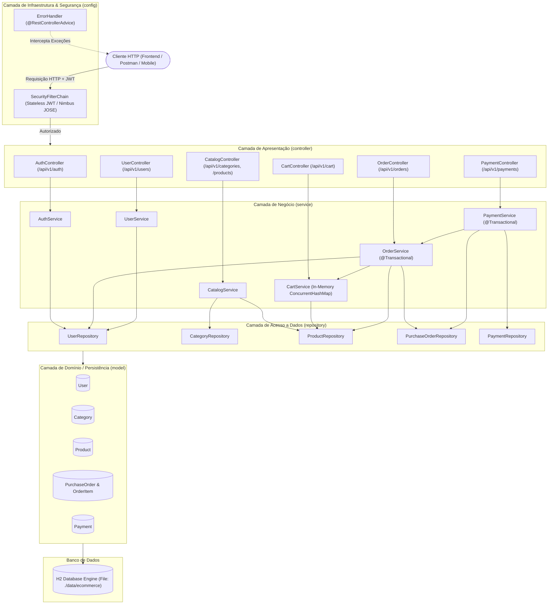
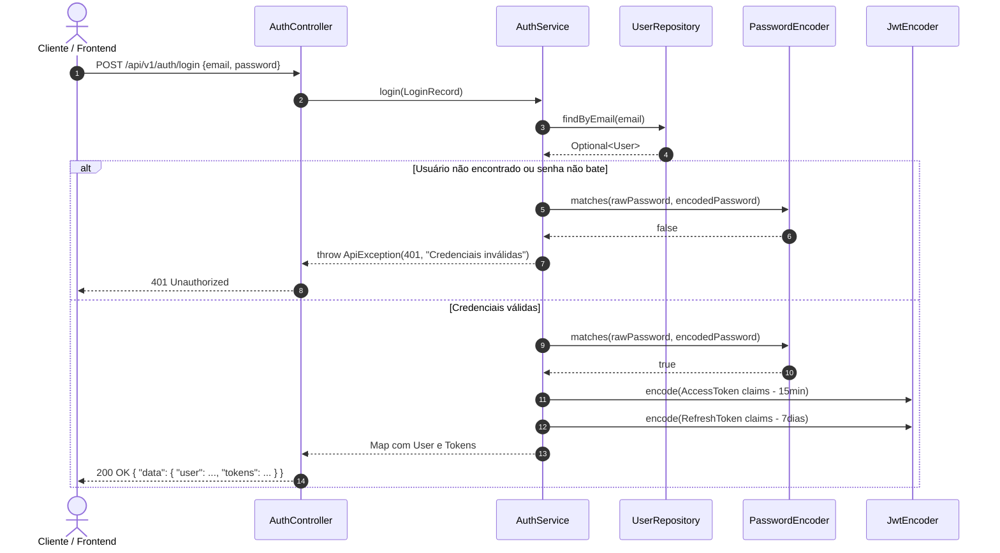
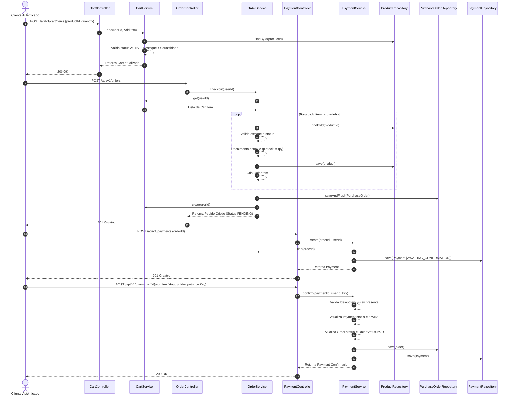

# Arquitetura do Sistema — E-commerce Spring Boot

## 1. Visão Arquitetural do Projeto

O sistema **ecommerce-springboot** adota o estilo arquitetural de **Monólito em Camadas (Layered Monolith)**, estruturado segundo o padrão clássico do ecossistema Spring: Apresentação (*Controllers* REST) $\rightarrow$ Lógica de Negócio (*Services*) $\rightarrow$ Acesso a Dados (*Repositories* via Spring Data JPA) $\rightarrow$ Entidades de Domínio e Persistência (*Models* JPA).

O projeto é resultado da migração de uma aplicação originalmente desenvolvida sobre a stack Node.js / Express / Prisma, convertida para **Java 21** e **Spring Boot 3.5.6**. Nesta variante ("sem docker"), o sistema opera de forma autônoma sem dependências de infraestrutura externa (como PostgreSQL ou Redis), utilizando banco de dados relacional embarcado/baseado em arquivo **H2** (`./data/ecommerce.mv.db`) e armazenamento de estado volátil de sessão/carrinho em memória RAM da JVM via `ConcurrentHashMap`.

### Diagrama Arquitetural de Camadas



---

## 2. Padrões Utilizados

| Padrão | Onde é aplicado no código | Descrição e Propósito no Projeto |
|---|---|---|
| **Layered Architecture (Camadas)** | Estrutura de pacotes `controller`, `service`, `repository`, `model`, `config` | Garante separação de interesses técnicos entre transporte HTTP, regras de domínio e persistência relacional. |
| **Controller-Service-Repository** | Fluxo de execução de todos os domínios da API | Desacopla controladores de detalhes de armazenamento e centraliza validações e orquestração em serviços. |
| **DTO com Java Records** | Declarados dentro das classes de serviço (ex: `AuthService.Register`, `CartService.AddItem`, `CatalogService.ProductInput`) | Imutabilidade e validação estruturada com Jakarta Validation (`@NotBlank`, `@Min`, `@Email`). |
| **Global Exception Handling** | `br.com.ecommerce.config.ErrorHandler` com `@RestControllerAdvice` | Intercepta `ApiException`, `MethodArgumentNotValidException` e `DataIntegrityViolationException`, padronizando o payload de erro HTTP. |
| **Stateless Authentication (JWT)** | `SecurityConfig` e `AuthService` | Autenticação sem sessão HTTP no servidor; tokens simétricos assinados com HMAC-SHA256 usando Nimbus JWT. |
| **In-Memory Cache/Storage** | `CartService` com `ConcurrentHashMap<String, String>` | Armazena estado temporário de carrinhos serializados em JSON via Jackson `ObjectMapper`. |
| **Transactional Script / Unit of Work** | Anotações `@Transactional` em `OrderService.checkout`, `PaymentService.confirm`, `PaymentService.cancel` | Garante atomicidade em operações de múltiplos passos (débito/estorno de estoque, criação de pedido, confirmação de pagamento). |
| **Idempotency Token (Simulado)** | `PaymentController.confirm` e `PaymentService.confirm` | Exige o cabeçalho HTTP `Idempotency-Key` antes de processar confirmação de pagamento. |

---

## 3. Regras Arquiteturais

1. **Isolamento e Fluxo Estrito de Chamadas**:
   - `Controller` invoca exclusivamente `Service`. É vedada a injeção ou invocação de `Repository` diretamente por qualquer `Controller`.
   - `Service` orquestra regras de negócio, validações de domínio e acesso aos `Repository`.
   - `Repository` estende exclusivamente interfaces Spring Data JPA (`JpaRepository<T, ID>`).

2. **Tratamento Padronizado de Erros**:
   - Falhas de regra de negócio devem lançar a exceção customizada `ApiException(HttpStatus, String)`.
   - O controlador global `ErrorHandler` formata respostas de erro seguindo a estrutura:
     ```json
     {
       "error": {
         "message": "Descrição amigável do erro",
         "code": "HTTP_STATUS_NAME"
       }
     }
     ```
   - Erros de validação estrutural (`@Valid`) retornam status `400 Bad Request` com lista detalhada de campos (`details`).

3. **Segurança e Controle de Acesso**:
   - Rotas de leitura do catálogo (`GET /api/v1/products/**`, `GET /api/v1/categories/**`) e endpoints de autenticação (`/api/v1/auth/**`) são totalmente públicas (`permitAll()`).
   - Console H2 (`/h2-console/**`) e métricas (`/actuator/health`) são acessíveis publicamente.
   - Rotas de alteração de catálogo (`POST`, `PUT`, `DELETE` em categorias e produtos) exigem perfil `ADMIN` via `@PreAuthorize("hasRole('ADMIN')")`.
   - Rotas de usuário (`/api/v1/users/{id}`) executam verificação de autorização baseada em titularidade (`id.equals(requester)`) ou permissão administrativa (`"ADMIN".equals(role)`).
   - O token JWT transporta a permissão no claim `role` (`USER` ou `ADMIN`), que é convertida pelo `JwtAuthenticationConverter` no prefixo padrão do Spring Security: `ROLE_USER` ou `ROLE_ADMIN`.

4. **Gerenciamento de Transações**:
   - Operações com múltiplos efeitos colaterais de persistência (ex: decremento de estoque + criação de itens de pedido + limpeza do carrinho) devem obrigatoriamente estar sob o escopo `@Transactional`.

---

## 4. Convenções Técnicas

- **Linguagem e Runtime**: Java 21 (utilização de Records, métodos auxiliares de Coleções, `Instant` para timestamps UTC).
- **Framework Core**: Spring Boot 3.5.6 (Spring Web, Spring Security 6, Spring Data JPA, Hibernate 6).
- **Tipagem de Identificadores (PKs)**: Todos os IDs primários são `String` contendo identificadores universais únicos no formato UUIDv4 (`UUID.randomUUID().toString()`).
- **Nomenclatura de Tabelas e Colunas**: Tabelas nomeadas no plural em minúsculo (`users`, `categories`, `products`, `orders`, `order_items`, `payments`), utilizando anotações JPA `@Table(name = "...")`.
- **Formatação de Valores Financeiros**: Utilização estrita de `java.math.BigDecimal` com precisão de 10 dígitos e escala de 2 casas decimais (`@Column(precision = 10, scale = 2)`).
- **Envelope de Resposta da API**:
  - Respostas de sucesso são encapsuladas em mapas chaveados por `"data"`: `Map.of("data", ...)`.
  - Respostas paginadas em catálogo contêm envelope com `"data"` e `"pagination"`.
- **Gerenciamento de Timestamps**: Entidades controlam datas de auditoria via campos `public Instant createdAt = Instant.now()` e `public Instant updatedAt = Instant.now()`.

---

## 5. Separação de Responsabilidades

| Pacote | Responsabilidade Técnica Principal | Componentes Integrantes |
|---|---|---|
| `br.com.ecommerce` | Ponto de entrada e bootstrap do container Spring Boot. | `EcommerceApplication.java` |
| `br.com.ecommerce.config` | Configuração transversal de segurança, encoders/decoders JWT e tratamento unificado de exceções REST. | `SecurityConfig.java`, `ErrorHandler.java` |
| `br.com.ecommerce.controller` | Recepção HTTP, deserialização de JSON, validação sintática (`@Valid`), extração de identidade autenticada (`@AuthenticationPrincipal Jwt`) e envio de resposta com status code adequado. | `AuthController`, `CartController`, `CatalogController`, `OrderController`, `PaymentController`, `UserController` |
| `br.com.ecommerce.service` | Concentração das regras de negócio, verificação de invariantes, controle transacional, hashing de senhas, emissão de tokens JWT e gestão de sessão de carrinho em memória. | `AuthService`, `CartService`, `CatalogService`, `OrderService`, `PaymentService`, `UserService`, `ApiException` |
| `br.com.ecommerce.repository` | Abstração de persistência sobre o H2 com Spring Data JPA. Declaração de consultas derivadas. | `CategoryRepository`, `PaymentRepository`, `ProductRepository`, `PurchaseOrderRepository`, `UserRepository` |
| `br.com.ecommerce.model` | Definição do esquema de dados mapeado para o banco relacional e enums que definem estados dos processos. | `Category`, `Product`, `PurchaseOrder`, `OrderItem`, `Payment`, `User`, `OrderStatus`, `ProductStatus`, `Role` |

---

## 6. Fluxo de Comunicação Entre Módulos

### 6.1. Fluxo de Autenticação e Emissão de Token



### 6.2. Fluxo de Compra: Carrinho $\rightarrow$ Checkout $\rightarrow$ Pagamento



---

## 7. Dependências Críticas

1. **Spring Boot Starter Web (`spring-boot-starter-web`)**:
   - Fornece o servidor de aplicação embutido Tomcat, suporte a anotações REST (`@RestController`, `@RequestMapping`), serialização e deserialização JSON via Jackson.
2. **Spring Boot Starter Security & OAuth2 Resource Server (`spring-boot-starter-security`, `spring-boot-starter-oauth2-resource-server`)**:
   - Implementa o pipeline de filtros de autenticação, interceptação de requisições, resolução de claims JWT (`NimbusJwtDecoder`, `NimbusJwtEncoder`) e controle de acesso RBAC com `@EnableMethodSecurity`.
3. **Spring Boot Starter Data JPA (`spring-boot-starter-data-jpa`)**:
   - Implementa o mapeamento objeto-relacional (ORM) com Hibernate e repositórios gerenciados pelo Spring Data.
4. **H2 Database Engine (`com.h2database:h2`)**:
   - Mecanismo de persistência relacional local baseado em arquivo. Substitui o PostgreSQL no modelo sem Docker.
5. **Jakarta Validation Starter (`spring-boot-starter-validation`)**:
   - Executa a validação declarativa de payloads de entrada com anotações padrão (`@NotBlank`, `@Email`, `@Min`, `@DecimalMin`, `@Size`).
6. **Nimbus JOSE JWT (`com.nimbusds:nimbus-jose-jwt`)**:
   - Utilizado internamente pelos encoders/decoders do Spring Security para geração e assinatura de tokens com chaves secretas simétricas HmacSHA256.

---

## 8. Riscos Técnicos e Acoplamentos Importantes

### 8.1. Riscos Técnicos Identificados

> [!WARNING]
> **Risco 1: Volatilidade do Carrinho em Memória (`CartService`)**
> O carrinho de compras está armazenado em um `ConcurrentHashMap<String, String>` na memória da JVM. Toda e qualquer reinicialização da aplicação ou queda do processo zera os carrinhos de todos os clientes. Além disso, torna impossível a execução em múltiplas instâncias (cluster/horizontal scaling) sem sticky session ou sincronização externa.

> [!CAUTION]
> **Risco 2: Carga em Memória e Risco de OutOfMemory no Catálogo (`CatalogService.products`)**
> O método `CatalogService.products(page, limit, search, categoryId)` chama `products.findAll()`, carregando **toda a tabela de produtos para a memória da JVM** para filtrar via Java Streams (`filter(...)`) e fazer paginação manual com `subList()`. Em catálogo com milhares de produtos, isso gerará picos extremos de consumo de heap, pausas de Garbage Collector e risco iminente de `OutOfMemoryError`.

> [!WARNING]
> **Risco 3: Concorrência e Race Condition na Baixa de Estoque (`OrderService.checkout`)**
> A verificação de estoque (`p.stock < item.quantity()`) e decremento (`p.stock -= item.quantity()`) são executados sem bloqueio pessimista (`PESSIMISTIC_WRITE`) e sem controle de versão otimista (`@Version`). Requisições concorrentes de compra para o mesmo produto com estoque baixo podem resultar em leituras sujas e **vendas em excesso (overselling)**.

> [!WARNING]
> **Risco 4: Falsa Idempotência no Pagamento (`PaymentService.confirm`)**
> O cabeçalho HTTP `Idempotency-Key` é apenas verificado para checar se é não-nulo ou não-vazio. A chave **não é gravada em tabela, nem verificada contra requisições anteriores**. Se duas requisições diferentes chegarem com a mesma chave, ou com parâmetros diferentes, o sistema não faz nenhum controle real de deduplicação idempotente.

> [!NOTE]
> **Risco 5: Falta de Endpoint e Persistência para Refresh Token (`AuthService`)**
> O `AuthService` gera e emite um `refreshToken` com validade de 7 dias, mas não existe nenhum endpoint na API (`/api/v1/auth/refresh`) que consuma esse token para emitir um novo `accessToken`, tornando o refresh token código morto/inútil no estado atual.

> [!NOTE]
> **Risco 6: Multi-tenancy Incompleto/Fictício**
> As entidades `Product`, `PurchaseOrder` e `User` possuem um campo `public String tenantId = "default";`. Contudo, nenhum repositório, service ou query filtra dados por tenant. Trata-se de implementação embrionária incompleta.

> [!WARNING]
> **Risco 7: Falta de Encapsulamento nas Entidades de Domínio**
> Todas as entidades JPA (`Product`, `Category`, `User`, `PurchaseOrder`, `Payment`, `OrderItem`) utilizam **campos públicos diretos** (`public String name; public int stock;`) sem encapsulamento com métodos assessores ou métodos de negócio. Isso permite mutação arbitrária de estado interno em qualquer camada.

> [!WARNING]
> **Risco 8: Ausência de Migrações de Banco de Dados**
> A configuração do JPA utiliza `ddl-auto: update` direto contra o H2. Não há versionamento de banco de dados via Flyway ou Liquibase, inviabilizando rastreabilidade e segurança em ambientes de produção.

> [!NOTE]
> **Risco 9: Inconsistência de Tipos de Status**
> `OrderStatus` e `ProductStatus` são enums tipados com validação estrita. Já `Payment.status` é uma `String` pura manipulada com literais mágicos (`"AWAITING_CONFIRMATION"`, `"PAID"`, `"CANCELED"`), sem proteção de tipagem em tempo de compilação.

### 8.2. Acoplamentos Relevantes e Métodos Órfãos

1. **Acoplamento Bidirecional / Quebra de Abstração em `PaymentService`**:
   - `PaymentService` depende de `OrderService` (para consultar pedidos) e **também injeta diretamente `PurchaseOrderRepository`** para persistir alterações de status do pedido (`orderRepo.save(p.order)`). O serviço de pagamento acessa a camada de dados de outro aggregate diretamente em vez de delegar para o `OrderService`.
2. **Método Órfão em `ProductRepository`**:
   - O método `Page<Product> findByNameContainingIgnoreCase(String search, Pageable pageable)` está declarado na interface `ProductRepository`, mas nunca é invocado em nenhum lugar da base de código, pois `CatalogService` faz filtro em memória.

---

## 9. Diretrizes para Futuras Implementações (Spec-Driven Development)

Para a evolução oficial do projeto no modelo **Spec-Driven Development (SDD)**, devem ser seguidas as diretrizes abaixo:

1. **Padronização de Contratos de API (OpenAPI / Swagger)**:
   - Substituir o retorno genérico `Object` dos controladores por DTOs de resposta fortemente tipados (`ResponseEntity<ApiResponse<T>>`).
   - Integrar `springdoc-openapi` para gerar a especificação OpenAPI 3.0 viva a partir dos contratos.
2. **Refatoração da Persistência de Carrinhos**:
   - Substituir o mapa em memória `ConcurrentHashMap` por um repositório baseado em Redis ou tabela de banco relacional com expiração (TTL), permitindo escalabilidade horizontal.
3. **Otimização da Busca e Paginação do Catálogo**:
   - Eliminar `products.findAll().stream()` em `CatalogService`.
   - Adotar Spring Data JPA `Pageable` diretamente nas consultas SQL geradas no banco (`ProductRepository.findAll(Specification, Pageable)`).
4. **Implementação de Controle de Concorrência de Estoque**:
   - Adicionar anotação `@Version private Long version;` na entidade `Product` para concorrência otimista, ou consulta com `LockModeType.PESSIMISTIC_WRITE` no `OrderService.checkout`.
5. **Implementação Real de Idempotência**:
   - Criar entidade `IdempotencyRecord` persistida no banco, armazenando a chave `Idempotency-Key`, hash da requisição, resposta serializada e data de expiração.
6. **Encapsulamento e Invariantes de Domínio**:
   - Tornar atributos de entidades `private` e criar métodos de domínio com intenção clara (ex: `product.deductStock(quantity)`, `order.markAsPaid()`).
7. **Pipeline de Testes**:
   - Substituir o teste esqueleto `EcommerceApplicationTests` por testes unitários com Mockito para Services e testes de integração com `@SpringBootTest` e `MockMvc` para endpoints e fluxos de checkout e segurança.
