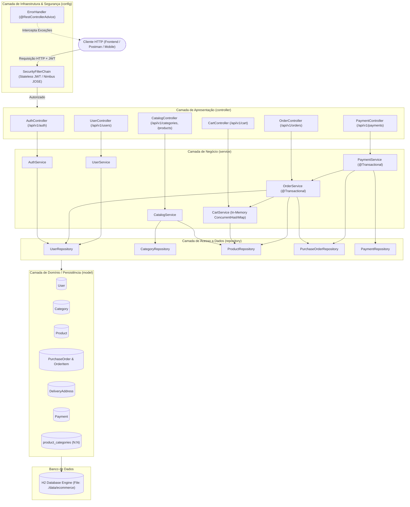
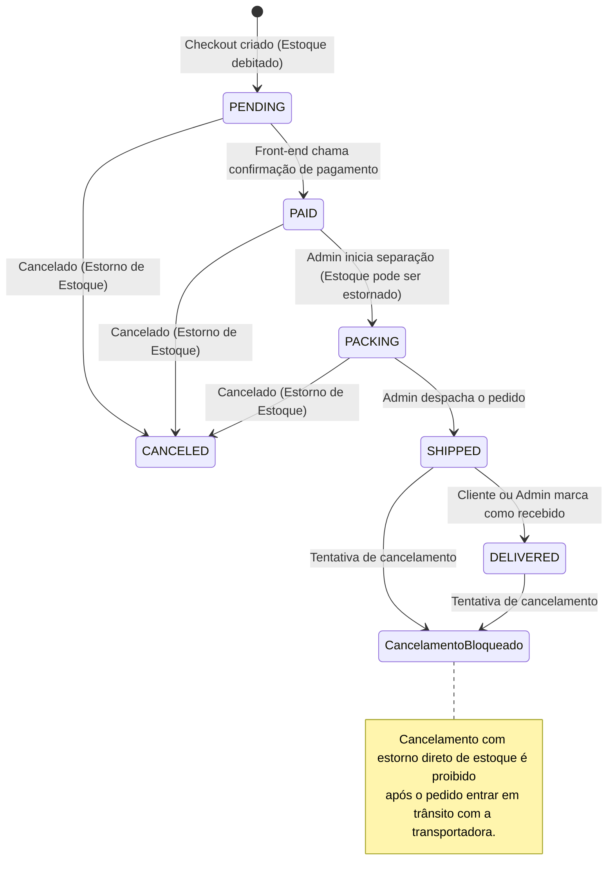
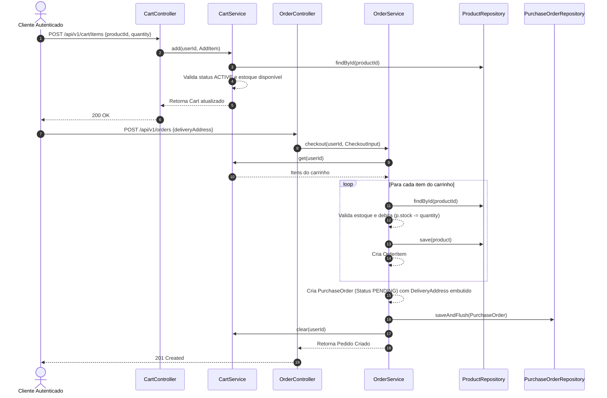
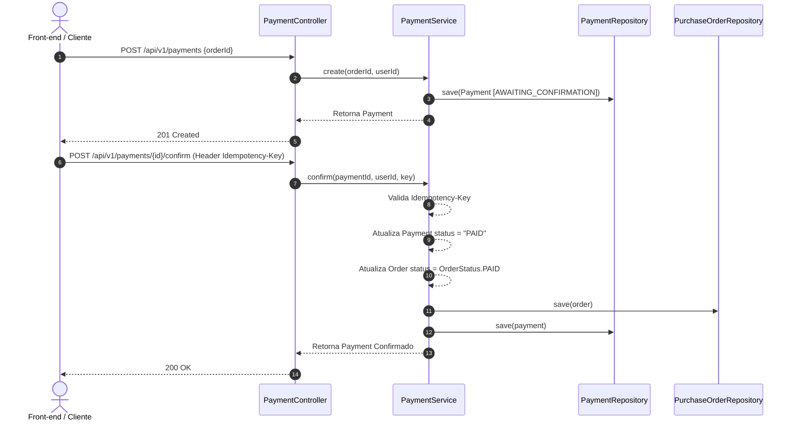

# Arquitetura do Sistema — E-commerce Spring Boot

## 1. Visão Arquitetural do Projeto

O sistema **ecommerce-springboot** adota o estilo arquitetural de **Monólito em Camadas (Layered Monolith)**, estruturado segundo o padrão clássico do ecossistema Spring: Apresentação (*Controllers* REST) $\rightarrow$ Lógica de Negócio (*Services*) $\rightarrow$ Acesso a Dados (*Repositories* via Spring Data JPA) $\rightarrow$ Entidades de Domínio e Persistência (*Models* JPA).

O sistema opera no modelo **Single-Tenant (loja única)** sobre **Java 21** e **Spring Boot 3.5.6**. Nesta variante ("sem docker"), o sistema utiliza banco de dados relacional embarcado/baseado em arquivo **H2** (`./data/ecommerce.mv.db`) e estado temporário de carrinho via `ConcurrentHashMap`, projetado para ser executado de forma local e autônoma.

### Diagrama Arquitetural de Camadas



---

## 2. Padrões Utilizados

| Padrão | Onde é aplicado no código | Descrição e Propósito no Projeto |
|---|---|---|
| **Layered Architecture (Camadas)** | Pacotes `controller`, `service`, `repository`, `model`, `config` | Garante separação de interesses técnicos entre transporte HTTP, regras de domínio e persistência relacional. |
| **Controller-Service-Repository** | Fluxo de execução de todos os domínios da API | Desacopla controladores de detalhes de armazenamento e centraliza validações e orquestração em serviços. |
| **DTO com Java Records** | Declarados dentro das classes de serviço (ex: `AuthService.Register`, `CartService.AddItem`, `OrderService.CheckoutInput`) | Imutabilidade e validação estruturada com Jakarta Validation (`@NotBlank`, `@Min`, `@Email`). |
| **Global Exception Handling** | `br.com.ecommerce.config.ErrorHandler` com `@RestControllerAdvice` | Intercepta `ApiException`, `MethodArgumentNotValidException` e violações de integridade, padronizando os erros HTTP. |
| **Stateless Authentication (JWT)** | `SecurityConfig` e `AuthService` | Autenticação sem sessão HTTP no servidor; tokens simétricos assinados com HMAC-SHA256 usando Nimbus JWT. |
| **Aggregate Composition** | `PurchaseOrder` compondo `OrderItem` e `DeliveryAddress` | O endereço de entrega e os itens do pedido compõem a raiz de agregação do pedido de forma atômica. |
| **Transactional Script / Unit of Work** | Anotações `@Transactional` em `OrderService.checkout`, `PaymentService.confirm`, `PaymentService.cancel` | Garante atomicidade em operações de múltiplos passos (débito/estorno de estoque, criação de pedido, confirmação de pagamento). |
| **Idempotency Token** | `PaymentController.confirm` e `PaymentService.confirm` | Exige o cabeçalho HTTP `Idempotency-Key` antes de processar confirmação de pagamento pelo front-end. |

---

## 3. Regras Arquiteturais e de Governança

1. **Isolamento de Camadas e Fluxo de Chamadas**:
   - `Controller` invoca exclusivamente `Service`. É vedada a injeção ou invocação de `Repository` diretamente por qualquer `Controller`.
   - `Service` orquestra regras de negócio, validações de domínio e acesso aos `Repository`.
   - `Repository` estende exclusivamente interfaces Spring Data JPA (`JpaRepository<T, ID>`).

2. **Segurança e Controle de Acesso (RBAC)**:
   - Rotas públicas (`permitAll()`): Consulta de catálogo (`GET /api/v1/products/**`, `GET /api/v1/categories/**`), autenticação (`/api/v1/auth/**`), console H2 (`/h2-console/**`) e métricas (`/actuator/health`).
   - **Gestão de Usuários**:
     - `DELETE /api/v1/users/{id}`: **Exclusiva para `ROLE_ADMIN`**. Usuários comuns não podem deletar suas próprias contas.
     - `PUT /api/v1/users/{id}/password`: Permitida ao próprio usuário logado (`id.equals(requester)`).
   - **Gestão de Catálogo**:
     - `POST`, `PUT`, `DELETE` em categorias e produtos exigem `ROLE_ADMIN`.
   - **Gestão de Pedidos e Entregas**:
     - `POST /api/v1/orders`: Requer autenticação (`ROLE_USER`).
     - `GET /api/v1/orders`: Retorna todos os pedidos pertencentes ao usuário logado (sem filtro). O administrador não possui rota específica para listar pedidos de um usuário específico.
     - `PATCH /api/v1/orders/{id}/status`: Exclusiva de `ROLE_ADMIN` para transições logísticas (`PACKING`, `SHIPPED`).
     - `PATCH /api/v1/orders/{id}/delivered`: Permite ao cliente (`USER` dono do pedido) ou ao `ADMIN` marcar como recebido.

3. **Invariantes de Catálogo e Múltiplas Categorias**:
   - `Category` suporta auto-relacionamento hierárquico com profundidade ilimitada (`parent` $\rightarrow$ `subcategories`).
   - `Product` possui relacionamento de muitos-para-muitos (`@ManyToMany`) com `Category` através da tabela de junção `product_categories`. Um produto pode estar presente em múltiplas categorias.
   - Produtos inativos (`status == INACTIVE`) devem ser filtrados diretamente na consulta SQL no banco, saindo imediatamente da visibilidade pública.

4. **Regras de Cancelamento e Atomicidade de Estoque**:
   - **Proibição de Cancelamento Parcial**: É estritamente vedado o cancelamento de itens isolados de um pedido. O cancelamento é sempre atômico e refere-se ao pedido completo.
   - **Regra de Estorno de Estoque Condicional por Status**:
     - Status `PENDING`, `PAID` ou `PACKING`: Cancelamento autorizado com **devolução automática do estoque** de todos os itens ao banco relacional.
     - Status `SHIPPED` ou `DELIVERED`: Cancelamento direto via API com estorno de estoque é **terminantemente bloqueado**, pois as mercadorias já foram despachadas ou entregues.

5. **Tratamento Padronizado de Erros**:
   - Falhas de regra de negócio devem lançar a exceção customizada `ApiException(HttpStatus, String)`.
   - O controlador global `ErrorHandler` formata respostas de erro seguindo a estrutura:
     ```json
     {
       "error": {
         "message": "Descrição amigável do erro",
         "code": "HTTP_STATUS_NAME"
       }
     }
     ```

---

## 4. Convenções Técnicas e Modelo de Dados

- **Linguagem e Runtime**: Java 21 LTS.
- **Framework Core**: Spring Boot 3.5.6 (Spring Web, Spring Security 6, Spring Data JPA, Hibernate 6).
- **Tipagem de Identificadores (PKs)**: Todos os IDs primários são `String` contendo identificadores universais únicos no formato UUIDv4 (`UUID.randomUUID().toString()`).
- **Nomenclatura de Tabelas**: Tabelas nomeadas no plural em minúsculo (`users`, `categories`, `products`, `orders`, `order_items`, `delivery_addresses`, `payments`, `product_categories`).
- **Valores Monetários**: `java.math.BigDecimal` com precisão de 10 dígitos e escala de 2 casas decimais (`@Column(precision = 10, scale = 2)`).
- **Single-Tenant**: O atributo `tenantId` foi formalmente eliminado de todo o domínio.

### Esquema do Ciclo de Estados do Pedido (`OrderStatus`)



---

## 5. Separação de Responsabilidades por Pacote

| Pacote | Responsabilidade Técnica Principal | Componentes Integrantes |
|---|---|---|
| `br.com.ecommerce` | Ponto de entrada e bootstrap do container Spring Boot. | `EcommerceApplication.java` |
| `br.com.ecommerce.config` | Configuração transversal de segurança, encoders/decoders JWT e tratamento unificado de exceções REST. | `SecurityConfig.java`, `ErrorHandler.java` |
| `br.com.ecommerce.controller` | Recepção HTTP, deserialização JSON, validação sintática (`@Valid`), extração de identidade autenticada (`@AuthenticationPrincipal Jwt`) e controle de acesso RBAC. | `AuthController`, `CartController`, `CatalogController`, `OrderController`, `PaymentController`, `UserController` |
| `br.com.ecommerce.service` | Concentração das regras de negócio, validações de domínio, controle transacional, hashing de senhas, emissão de tokens JWT e gestão de sessão de carrinho. | `AuthService`, `CartService`, `CatalogService`, `OrderService`, `PaymentService`, `UserService`, `ApiException` |
| `br.com.ecommerce.repository` | Abstração de persistência sobre o H2 com Spring Data JPA. Declaração de consultas derivadas. | `CategoryRepository`, `PaymentRepository`, `ProductRepository`, `PurchaseOrderRepository`, `UserRepository` |
| `br.com.ecommerce.model` | Definição do esquema de dados mapeado para o banco relacional e enums que definem estados dos processos. | `Category`, `Product`, `PurchaseOrder`, `OrderItem`, `DeliveryAddress`, `Payment`, `User`, `OrderStatus`, `ProductStatus`, `Role` |

---

## 6. Fluxos de Execução Detalhados

### 6.1. Fluxo de Compra e Checkout com Composição de Endereço



### 6.2. Fluxo de Confirmação de Pagamento Acionada pelo Front-end



---

## 7. Riscos Técnicos e Decisões de Arquitetura

### 7.1. Decisões Arquiteturais Consolidadas na Entrevista
1. **Descarte de Multi-Tenancy**: O projeto é exclusivamente Single-Tenant. O atributo `tenantId` foi removido do domínio, eliminando complexidade acidental desnecessária.
2. **Produtos Multicategoria (`@ManyToMany`)**: A restrição legada de 1 categoria por produto foi superada em favor de uma relação muitos-para-muitos (`product_categories`), permitindo categorização rica e flexível.
3. **Imutabilidade e Segurança no Pós-Venda**: Ao bloquear estorno de estoque em pedidos despachados (`SHIPPED`) ou entregues (`DELIVERED`), eliminam-se inconsistências físicas e financeiras de inventário.
4. **Governança de Usuários**: A exclusão de contas foi restrita ao `ADMIN` para proteger o histórico de auditoria e a integridade referencial dos pedidos faturados.

### 7.2. Riscos Técnicos Remanescentes para Mitigação Futura

> [!WARNING]
> **Risco 1: Volatilidade do Carrinho em Memória (`CartService`)**
> O carrinho ainda está em `ConcurrentHashMap`. Para manter o projeto autônomo e sem Docker, a migração definitiva recomendada é persistir o carrinho em tabelas relacionais (`carts` e `cart_items`) no banco H2.

> [!CAUTION]
> **Risco 2: Carga em Memória no Catálogo (`CatalogService.products`)**
> O método de listagem de produtos ainda carrega todos os registros com `findAll()` para filtrar em memória via Stream. Deve ser refatorado para utilizar Spring Data JPA `Pageable` e filtros nativos no banco (`WHERE status = 'ACTIVE'`).

> [!WARNING]
> **Risco 3: Concorrência na Baixa de Estoque (`OrderService.checkout`)**
> O decremento de estoque ainda ocorre sem bloqueio pessimista ou controle otimista (`@Version`), mantendo o risco de *overselling* em requisições de compra concorrentes.
