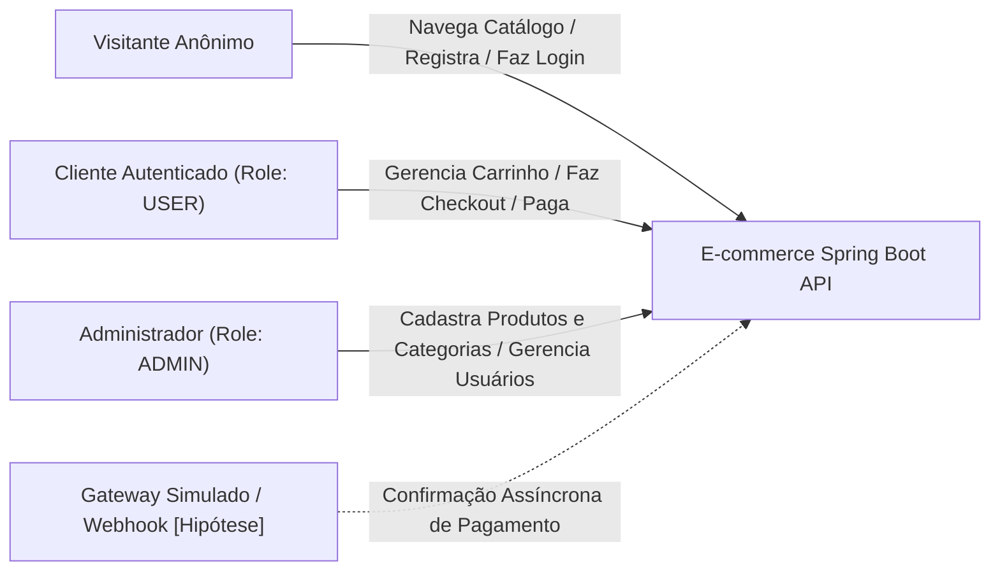
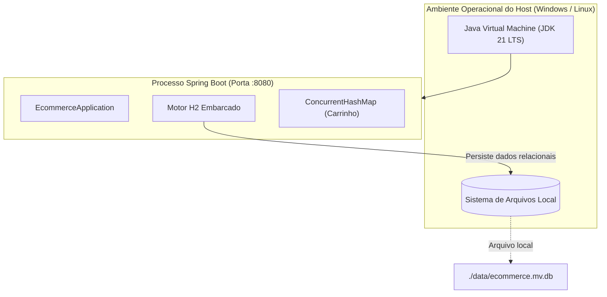

# Objetivo do Sistema — E-commerce Spring Boot

## 1. Propósito Principal do Sistema

O **ecommerce-springboot** tem como propósito central fornecer uma **API RESTful de comércio eletrônico**, atuando como o motor transacional de backend para operações de cadastro e consulta de catálogo, autenticação segura de usuários, gerenciamento de carrinhos de compras em sessão, fechamento de pedidos com baixa de estoque e liquidação/cancelamento de pagamentos simulados.

O sistema atua como o núcleo operacional e de regras de negócio, projetado para desacoplar a interface com o usuário (aplicações web, mobile ou pontos de venda) da persistência de dados e regras de domínio comercial.

---

## 2. Problemas que o Sistema Resolve

| Problema Identificado no Mercado / Domínio | Como o Sistema Soluciona |
|---|---|
| **Fragmentação de Identidades e Acesso** | Centraliza o registro e login de usuários, emitindo tokens criptográficos stateless (JWT HS256) com controle de acesso baseado em papéis (RBAC - `USER` e `ADMIN`). |
| **Desatualização e Exibição de Produtos Indisponíveis** | Gerencia catálogo hierárquico com status ativo/inativo e valida a existência e estoque antes de permitir inclusão em carrinho ou faturamento. |
| **Abandono e Gestão de Intenção de Compra** | Disponibiliza endpoints dedicados de carrinho para adição, listagem e remoção de itens, calculando somatórios automaticamente. |
| **Risco de Venda sem Estoque Físico** | No momento do checkout (`OrderService.checkout`), revalida o estoque e realiza o decremento imediato dentro de uma transação atômica (`@Transactional`). |
| **Falta de Rastreabilidade Financeira do Pedido** | Cria um registro de pagamento acoplado ao pedido, permitindo acompanhar o ciclo de vida (`AWAITING_CONFIRMATION` $\rightarrow$ `PAID` ou `CANCELED`). |
| **Perda de Itens em Caso de Desistência/Cancelamento** | Caso um pagamento seja cancelado antes de pago, os itens associados ao pedido têm suas quantidades estornadas automaticamente ao estoque do produto. |

---

## 3. Principais Fluxos de Negócio

### 3.1. Fluxo de Onboarding e Autenticação
1. O usuário anônimo submete nome, e-mail e senha (`POST /api/v1/auth/register`).
2. O sistema verifica a unicidade do e-mail no banco H2.
3. A senha é criptografada com algoritmo BCrypt e o usuário é persistido com o papel `USER`.
4. O sistema retorna o usuário criado acompanhado de tokens JWT (`accessToken` de 15 minutos e `refreshToken` de 7 dias).
5. O usuário utiliza o token `Bearer` no cabeçalho `Authorization` para as requisições subsequentes.

### 3.2. Fluxo de Navegação e Catálogo
1. Qualquer visitante (autenticado ou público) pode listar categorias (`GET /api/v1/categories`) e produtos (`GET /api/v1/products`).
2. A listagem de produtos suporta paginação (`page`, `limit`), busca por substring no nome (`search`) e filtragem por categoria (`categoryId`).
3. Administradores autenticados com claim `role: "ADMIN"` podem criar, atualizar e excluir categorias e produtos.

### 3.3. Fluxo de Montagem do Carrinho
1. O cliente autenticado adiciona um item ao carrinho (`POST /api/v1/cart/items`), informando `productId` e `quantity`.
2. O sistema valida se o produto existe, se está com status `ACTIVE` e se o estoque disponível atende à quantidade total requisitada.
3. O item é persistido no armazenamento de carrinho em memória indexado por `cart:default:{userId}`.
4. O cliente pode consultar o carrinho (`GET /api/v1/cart`) ou remover produtos específicos (`DELETE /api/v1/cart/items/{itemId}`).

### 3.4. Fluxo de Checkout e Fechamento de Pedido
1. O cliente requisita o fechamento da compra (`POST /api/v1/orders`).
2. O sistema recupera os itens do carrinho do usuário. Se estiver vazio, rejeita com erro `400 Bad Request`.
3. Para cada item, o sistema revalida status do produto e saldo de estoque no banco.
4. O estoque do produto é debitado (`stock = stock - quantity`).
5. Um registro de `PurchaseOrder` com status `PENDING` e seus respectivos `OrderItem` são persistidos de forma transacional.
6. O carrinho do usuário é esvaziado. O pedido criado é retornado ao cliente.

### 3.5. Fluxo de Liquidação e Cancelamento de Pagamento
1. O cliente cria uma intenção de pagamento para seu pedido (`POST /api/v1/payments`, enviando `orderId`).
2. O sistema valida se o pedido pertence ao usuário autenticado e cria o registro de `Payment` com status `AWAITING_CONFIRMATION`.
3. **Confirmação**: Ao receber `POST /api/v1/payments/{id}/confirm` com o cabeçalho `Idempotency-Key`, o sistema transiciona o status do pagamento para `PAID` e o status do pedido para `OrderStatus.PAID`.
4. **Cancelamento**: Ao receber `POST /api/v1/payments/{id}/cancel`, se o pagamento ainda não estiver pago, o sistema altera o status do pagamento para `CANCELED`, o status do pedido para `OrderStatus.CANCELED` e restaura as quantidades de cada item ao estoque de cada produto.

---

## 4. Atores Envolvidos

1. **Visitante Anônimo**:
   - Não possui autenticação ativa.
   - Permissões: Consultar categorias e produtos; registrar nova conta (`/register`); realizar login (`/login`); acessar endpoints de saúde (`/actuator/health`).
2. **Cliente Autenticado (Role: `USER`)**:
   - Usuário comum que possui credencial válida e token JWT.
   - Permissões: Visualizar e manipular seu próprio carrinho de compras; fechar pedidos a partir do carrinho; criar pagamentos; confirmar e cancelar pagamentos de seus próprios pedidos; consultar e atualizar seus próprios dados cadastrais.
3. **Administrador (Role: `ADMIN`)**:
   - Usuário com privilégios de gestão operacional.
   - Permissões: Todas as permissões do Cliente; criar, editar e excluir categorias de produtos; criar, editar e excluir produtos do catálogo; consultar, atualizar ou excluir a conta de qualquer usuário cadastrado no sistema.
4. **Gateway Externo de Pagamento [Hipótese / Contexto Futuro]**:
   - No estado atual do código, a confirmação de pagamento é disparada diretamente via HTTP pelo próprio cliente da API. [Hipótese] Em uma evolução comercial, este ator representará provedores como Stripe, Mercado Pago ou Pagar.me disparando webhooks de confirmação.

---

## 5. Funcionalidades Centrais

| Domínio | Endpoint | Método | Nível de Acesso | Descrição Operacional |
|---|---|---|---|---|
| **Autenticação** | `/api/v1/auth/register` | `POST` | Público | Registra novo usuário, criptografa senha com BCrypt e emite tokens. |
| **Autenticação** | `/api/v1/auth/login` | `POST` | Público | Autentica credenciais (e-mail/senha) e emite par de tokens JWT. |
| **Catálogo** | `/api/v1/categories` | `GET` | Público | Retorna a listagem completa de categorias. |
| **Catálogo** | `/api/v1/categories/{id}` | `GET` | Público | Retorna os detalhes de uma categoria específica por ID. |
| **Catálogo** | `/api/v1/categories` | `POST` | ADMIN | Cria uma nova categoria (suporta categoria pai opcional). |
| **Catálogo** | `/api/v1/categories/{id}` | `PUT` | ADMIN | Atualiza dados cadastrais de uma categoria existente. |
| **Catálogo** | `/api/v1/categories/{id}` | `DELETE` | ADMIN | Remove uma categoria existente do banco de dados. |
| **Catálogo** | `/api/v1/products` | `GET` | Público | Lista produtos com suporte a busca textual, categoria e paginação. |
| **Catálogo** | `/api/v1/products/{id}` | `GET` | Público | Retorna detalhes de um produto por ID. |
| **Catálogo** | `/api/v1/products` | `POST` | ADMIN | Cadastra novo produto no catálogo (valida unicidade de SKU). |
| **Catálogo** | `/api/v1/products/{id}` | `PUT` | ADMIN | Atualiza atributos de um produto existente. |
| **Catálogo** | `/api/v1/products/{id}` | `DELETE` | ADMIN | Remove um produto do catálogo. |
| **Carrinho** | `/api/v1/cart` | `GET` | Autenticado | Retorna o carrinho do usuário logado e o somatório dos itens. |
| **Carrinho** | `/api/v1/cart/items` | `POST` | Autenticado | Adiciona produto ao carrinho validando status e estoque disponível. |
| **Carrinho** | `/api/v1/cart/items/{itemId}` | `DELETE` | Autenticado | Remove um item específico do carrinho do usuário autenticado. |
| **Pedidos** | `/api/v1/orders` | `GET` | Autenticado | Lista todos os pedidos pertencentes ao usuário logado. |
| **Pedidos** | `/api/v1/orders` | `POST` | Autenticado | Converte os itens do carrinho em pedido (`PENDING`), dando baixa no estoque. |
| **Pagamentos** | `/api/v1/payments` | `POST` | Autenticado | Cria intenção de pagamento associada a um pedido com status pendente. |
| **Pagamentos** | `/api/v1/payments/{id}/confirm` | `POST` | Autenticado | Confirma o pagamento (exige `Idempotency-Key`) e marca pedido como `PAID`. |
| **Pagamentos** | `/api/v1/payments/{id}/cancel` | `POST` | Autenticado | Cancela o pagamento e pedido, estornando itens de volta ao estoque. |
| **Usuários** | `/api/v1/users/{id}` | `GET` | Próprio / ADMIN | Retorna dados cadastrais do usuário (requer correspondência de ID ou ADMIN). |
| **Usuários** | `/api/v1/users/{id}` | `PUT` | Próprio / ADMIN | Atualiza nome, e-mail ou senha do usuário informado. |
| **Usuários** | `/api/v1/users/{id}` | `DELETE` | Próprio / ADMIN | Exclui o cadastro do usuário. |

---

## 6. Visão de Produto

### 6.1. Posicionamento
O sistema se posiciona como uma **plataforma headless de comércio eletrônico**, fornecendo uma camada de serviços estável e padronizada que serve como alicerce transacional para múltiplos canais de venda (lojas virtuais em Next.js/React, aplicativos móveis Android/iOS ou integrações de marketplace).

### 6.2. Estado Atual do Produto
- **Estágio de Maturidade**: Protótipo funcional migrado de referência (Proof of Concept / Baseline operacional).
- **Ambiente Vigente**: Configuração simplificada "sem docker", projetada para desenvolvimento rápido local sem requisitos de conteinerização.
- **Limitações do Estado Atual**:
  - Simulação de pagamentos (não há conexão com gateway financeiro real).
  - Carrinhos efêmeros na memória da aplicação.
  - Paginação e filtros de catálogo processados em memória após carregar todos os registros.
  - Ausência de suíte de testes automatizados com cobertura de cenários de integração.

### 6.3. Roadmap Estratégico de Evolução [Hipótese de Produto]
1. **Fase 1 (Robustez e Resiliência)**: Substituição do H2 por banco relacional enterprise (PostgreSQL), adoção de Redis distribuído para sessão/carrinho e migração de banco via Flyway.
2. **Fase 2 (Integração e Pagamentos Reais)**: Integração com provedor real de pagamento (ex: Pix / Cartão via Webhooks), persistência real de logs de idempotência e sistema de notificação assíncrona por e-mail.
3. **Fase 3 (Multi-tenancy Real)**: Ativação e isolamento efetivo do atributo `tenantId` já existente no modelo para viabilizar múltiplos lojistas na mesma infraestrutura.

---

## 7. Contexto Operacional do Sistema

### Configurações de Execução e Variáveis
- **Porta do Servidor**: Padrão `8080`, configurável via variável de ambiente `PORT`.
- **String de Conexão JDBC**: `jdbc:h2:file:./data/ecommerce;DB_CLOSE_ON_EXIT=FALSE` (armazena arquivos locais `./data/ecommerce.mv.db` e `./data/ecommerce.trace.db`).
- **Credenciais do Banco Local**: Usuário `sa`, senha vazia `""`.
- **Chave Secreta de Assinatura JWT**: Configurada em `app.jwt-secret`, sobrescrevível via variável de ambiente `JWT_SECRET`. Valor padrão: `change-this-development-only-secret-32-characters-minimum`.
- **Console Administrativo do Banco**: Habilitado em `http://localhost:8080/h2-console`.

### Restrições Operacionais Críticas
- **Persistência de Carrinhos**: Reiniciar o processo da aplicação apaga instantaneamente todos os carrinhos de compras ativos.
- **Concorrência Mono-instância**: Devido ao lock de arquivo exclusivo do H2 (`ecommerce.mv.db`) e ao estado de carrinho em memória, o sistema não pode ser executado em mais de uma instância simultânea apontando para a mesma pasta.
