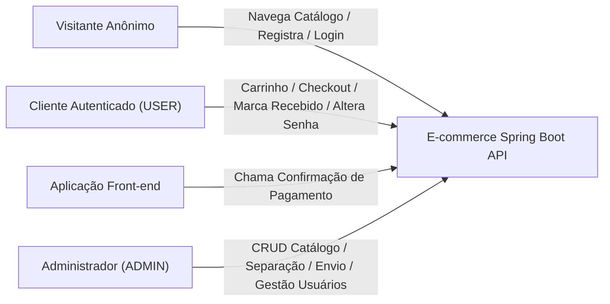

# Objetivo do Sistema — E-commerce Spring Boot

## 1. Propósito Principal do Sistema

O **ecommerce-springboot** tem como propósito central fornecer uma **API RESTful de comércio eletrônico**, atuando como o motor transacional de backend para operações de cadastro e consulta de catálogo, autenticação segura de usuários, gerenciamento de carrinhos de compras em sessão, fechamento de pedidos com composição de endereço de entrega, controle de ciclo de vida de pedidos físicos com baixa/estorno de estoque condicional e liquidação de pagamentos acionada pelo front-end.

O sistema opera no modelo **Single-Tenant (loja única)**, centralizando todos os produtos, clientes e pedidos em uma única estrutura de domínio, sem segregação de inquilinos.

---

## 2. Problemas que o Sistema Resolve

| Problema Identificado no Mercado / Domínio | Como o Sistema Soluciona |
|---|---|
| **Fragmentação de Identidades e Acesso** | Centraliza o registro e login de usuários, emitindo tokens criptográficos stateless (JWT HS256) com controle de acesso baseado em papéis (RBAC - `USER` e `ADMIN`). |
| **Exclusão Indevida de Contas e Perda de Histórico** | Restringe a exclusão de contas exclusivamente ao `ADMIN`, permitindo ao usuário logado alterar sua própria senha com segurança. |
| **Rigidez na Categorização de Produtos** | Permite que categorias possuam profundidade hierárquica livre/infinita e que um produto pertença a múltiplas categorias simultaneamente (`@ManyToMany`). |
| **Exibição de Produtos Indisponíveis no Catálogo** | Produtos desativados (`INACTIVE`) saem imediatamente das listagens públicas de catálogo no momento da consulta. |
| **Inconsistência de Endereço no Despacho Físico** | Compõe o endereço de entrega (`DeliveryAddress`) diretamente no pedido no momento do checkout, congelando as informações de entrega. |
| **Risco de Venda sem Estoque Físico** | No momento do checkout (`OrderService.checkout`), revalida o estoque e realiza o decremento imediato dentro de uma transação atômica (`@Transactional`). |
| **Quebra de Integridade por Cancelamentos Parciais** | Proíbe terminantemente cancelamentos parciais de itens: o cancelamento de pedido é sempre atômico (pedido total). |
| **Vazamento e Inconsistência de Estoque no Pós-Venda** | Regula o estorno de estoque por status: o estoque só é estornado se o pedido estiver em `PENDING`, `PAID` ou `PACKING`. Uma vez marcado como `SHIPPED` ou `DELIVERED`, o cancelamento com estorno direto de estoque é terminantemente bloqueado. |

---

## 3. Principais Fluxos de Negócio

### 3.1. Fluxo de Onboarding, Autenticação e Gestão de Perfil
1. O usuário anônimo submete nome, e-mail e senha (`POST /api/v1/auth/register`).
2. O sistema valida a unicidade do e-mail no banco H2, criptografa a senha com BCrypt e persiste o usuário com papel `USER`.
3. O sistema emite par de tokens JWT (`accessToken` de 15 minutos e `refreshToken` de 7 dias).
4. O usuário logado pode alterar sua própria senha (`PUT /api/v1/users/{id}/password`).
5. Apenas o administrador (`ADMIN`) tem permissão de excluir usuários (`DELETE /api/v1/users/{id}`). O próprio usuário não pode deletar sua conta.

### 3.2. Fluxo de Catálogo e Múltiplas Categorias
1. Visitantes e clientes consultam a hierarquia de categorias (`GET /api/v1/categories`), que suporta profundidade ilimitada de subcategorias.
2. Visitantes consultam o catálogo de produtos (`GET /api/v1/products`).
3. Produtos desativados (`ProductStatus.INACTIVE`) são filtrados imediatamente na fonte de dados e não aparecem na listagem pública.
4. Um produto pode estar associado a múltiplas categorias. A busca permite filtrar produtos por categoria mantendo suporte a paginação e busca textual.
5. Administradores (`ADMIN`) realizam o CRUD completo de categorias e produtos.

### 3.3. Fluxo de Montagem do Carrinho
1. O cliente autenticado adiciona itens ao carrinho (`POST /api/v1/cart/items`), informando `productId` e `quantity`.
2. O sistema valida se o produto existe, se está `ACTIVE` e se há estoque suficiente.
3. O item é persistido no armazenamento de carrinho vinculado ao usuário autenticado.
4. O cliente pode consultar o carrinho (`GET /api/v1/cart`) ou remover itens específicos (`DELETE /api/v1/cart/items/{itemId}`).

### 3.4. Fluxo de Checkout com Endereço de Entrega
1. O cliente requisita o fechamento da compra (`POST /api/v1/orders`), enviando os dados de entrega (`DeliveryAddress`: CEP, logradouro, número, complemento, bairro, cidade, UF).
2. O sistema valida se o carrinho contém itens.
3. Para cada item, revalida status do produto e estoque disponível no banco.
4. O estoque de cada produto é debitado imediatamente.
5. O pedido é criado com status `PENDING`, contendo os itens com snapshot de preço e a entidade embutida de endereço de entrega.
6. O carrinho do usuário é esvaziado.

### 3.5. Fluxo de Pagamento Acionado pelo Front-end
1. O cliente cria a intenção de pagamento para o pedido (`POST /api/v1/payments`, informando `orderId`).
2. O registro de `Payment` é criado com status `AWAITING_CONFIRMATION`.
3. O front-end conclui a interação financeira e aciona a rota de confirmação de pagamento (`POST /api/v1/payments/{id}/confirm` com cabeçalho `Idempotency-Key`).
4. O sistema valida a requisição, atualiza o status do pagamento para `PAID` e transiciona o pedido de `PENDING` para `PAID`.

### 3.6. Fluxo de Cumprimento de Pedido (Fulfillment e Logística)
1. **Em Separação (`PACKING`)**: O administrador altera o status do pedido de `PAID` para `PACKING` (`PATCH /api/v1/orders/{id}/status`) para início da separação física dos produtos no estoque.
2. **Enviado (`SHIPPED`)**: Após empacotado e despachado para a transportadora, o administrador altera o status para `SHIPPED`, registrando opcionalmente o código de rastreamento.
3. **Entregue (`DELIVERED`)**:
   - O próprio cliente (`USER`) pode acessar seu pedido e marcar como recebido (`PATCH /api/v1/orders/{id}/delivered`).
   - O administrador (`ADMIN`) também possui permissão para marcar o pedido como entregue via rota administrativa de status.

### 3.7. Fluxo de Cancelamento e Regras de Estorno de Estoque
1. **Atomicidade Estrita**: O cancelamento opera exclusivamente sobre o pedido completo. É proibido o cancelamento parcial de itens.
2. **Condição de Estorno**:
   - Se o pedido estiver em `PENDING`, `PAID` ou `PACKING`, a requisição de cancelamento (`DELETE /order/{id}` ou cancelamento de pagamento) altera o status para `CANCELED` e **restaura integralmente as quantidades de todos os itens ao estoque dos produtos**.
   - Se o pedido já tiver sido marcado como `SHIPPED` ou `DELIVERED`, o cancelamento com estorno direto de estoque é **terminantemente bloqueado**, pois os produtos já estão em trânsito com a transportadora ou na posse do cliente.

---

## 4. Atores Envolvidos e Matriz de Acesso

### 1. Visitante Anônimo
- Permissões: Consultar catálogo de produtos ativos e árvore de categorias; registrar nova conta (`/register`); realizar login (`/login`); verificar saúde da API (`/actuator/health`).

### 2. Cliente Autenticado (`ROLE_USER`)
- Permissões:
  - Gerenciar seu próprio carrinho de compras.
  - Fechar pedido informando endereço de entrega.
  - Listar todos os seus próprios pedidos (`GET /api/v1/orders`, listagem direta sem filtros).
  - Confirmar recebimento do seu pedido, transicionando para `DELIVERED`.
  - Cancelar seu próprio pedido enquanto o status for `PENDING`, `PAID` ou `PACKING` (com estorno de estoque).
  - Alterar sua própria senha de acesso.
- **Restrições**: Não pode alterar status de envio (`PACKING`, `SHIPPED`); não pode excluir sua própria conta; não pode cancelar pedidos já enviados; não pode fazer cancelamento parcial de itens.

### 3. Administrador (`ROLE_ADMIN`)
- Permissões:
  - Gerenciamento total de categorias (árvore ilimitada) e produtos (múltiplas categorias).
  - Excluir contas de qualquer usuário cadastrado (função exclusiva de admin).
  - Atualizar status logístico de pedidos (`PACKING`, `SHIPPED`, `DELIVERED`).
  - Cancelar pedidos em conformidade com as regras de status.
- **Definição de Escopo**: O admin não possui rota para filtrar ou listar pedidos por um usuário específico; sua visão é operacional sobre os pedidos globais da loja.

### 4. Aplicação Front-end
- Atua como a interface orquestradora: coleta dados de pagamento e invoca ativamente o endpoint de confirmação de pagamento (`POST /api/v1/payments/{id}/confirm`) após o processamento financeiro.

---

## 5. Matriz de Estados do Pedido (`OrderStatus`)

| Status | Descrição | Quem altera para este status? | Permite Cancelamento com Estorno de Estoque? |
|---|---|---|:---:|
| `PENDING` | Pedido gerado no checkout, aguardando liquidação | Sistema | ✅ Sim |
| `PAID` | Pagamento aprovado via chamada do front-end | Front-end / Sistema | ✅ Sim |
| `PACKING` | Pedido em processo de separação física e empacotamento | `ADMIN` | ✅ Sim |
| `SHIPPED` | Pedido despachado para entrega com transportadora | `ADMIN` | ❌ **Bloqueado** |
| `DELIVERED` | Pedido entregue ao destinatário final | `USER` (marcar recebido) ou `ADMIN` | ❌ **Bloqueado** |
| `CANCELED` | Pedido cancelado integralmente | `USER` ou `ADMIN` (se elegível) | — |

---

## 6. Funcionalidades Centrais e Endpoints

| Domínio | Endpoint | Método | Nível de Acesso | Descrição Operacional |
|---|---|---|---|---|
| **Autenticação** | `/api/v1/auth/register` | `POST` | Público | Registra novo usuário com papel `USER`. |
| **Autenticação** | `/api/v1/auth/login` | `POST` | Público | Autentica credenciais e emite tokens JWT. |
| **Usuários** | `/api/v1/users/{id}/password` | `PUT` | Próprio / Logado | Permite ao usuário logado alterar sua própria senha. |
| **Usuários** | `/api/v1/users/{id}` | `GET` | Próprio / ADMIN | Consulta dados cadastrais do usuário. |
| **Usuários** | `/api/v1/users/{id}` | `PUT` | Próprio / ADMIN | Atualiza dados cadastrais (nome, e-mail). |
| **Usuários** | `/api/v1/users/{id}` | `DELETE` | **Exclusivo ADMIN** | Exclui a conta do usuário especificado. |
| **Catálogo** | `/api/v1/categories` | `GET` | Público | Retorna árvore de categorias com profundidade ilimitada. |
| **Catálogo** | `/api/v1/categories` | `POST` | ADMIN | Cadastra categoria (suporta categoria pai para hierarquia). |
| **Catálogo** | `/api/v1/categories/{id}` | `PUT` / `DELETE` | ADMIN | Atualiza ou remove categoria. |
| **Catálogo** | `/api/v1/products` | `GET` | Público | Lista produtos ativos (`ACTIVE`). Produtos inativos são excluídos da resposta. |
| **Catálogo** | `/api/v1/products/{id}` | `GET` | Público | Retorna detalhes do produto e suas categorias associadas. |
| **Catálogo** | `/api/v1/products` | `POST` | ADMIN | Cadastra produto associando a uma ou mais categorias (`categoryIds`). |
| **Catálogo** | `/api/v1/products/{id}` | `PUT` / `DELETE` | ADMIN | Atualiza atributos/categorias ou remove produto do catálogo. |
| **Carrinho** | `/api/v1/cart` | `GET` | Autenticado | Retorna carrinho e somatório de itens do usuário autenticado. |
| **Carrinho** | `/api/v1/cart/items` | `POST` | Autenticado | Adiciona produto ao carrinho validando status ativo e estoque. |
| **Carrinho** | `/api/v1/cart/items/{itemId}` | `DELETE` | Autenticado | Remove item do carrinho. |
| **Pedidos** | `/api/v1/orders` | `GET` | Autenticado | Lista todos os pedidos pertencentes ao usuário logado (sem filtro). |
| **Pedidos** | `/api/v1/orders` | `POST` | Autenticado | Cria pedido com `DeliveryAddress`, debita estoque e limpa carrinho. |
| **Pedidos** | `/api/v1/orders/{id}/status` | `PATCH` | **ADMIN** | Atualiza status operacional para `PACKING` ou `SHIPPED`. |
| **Pedidos** | `/api/v1/orders/{id}/delivered` | `PATCH` | Próprio / ADMIN | Marca o pedido como recebido (`DELIVERED`). |
| **Pedidos** | `/order/{id}` | `DELETE` | Próprio / ADMIN | Cancela o pedido via RESTful DELETE (estorna estoque se `PENDING`, `PAID` ou `PACKING`). |
| **Pagamentos** | `/api/v1/payments` | `POST` | Autenticado | Cria intenção de pagamento vinculada ao pedido. |
| **Pagamentos** | `/api/v1/payments/{id}/confirm` | `POST` | Autenticado (Front) | Confirma pagamento com `Idempotency-Key` e marca pedido como `PAID`. |
| **Pagamentos** | `/api/v1/payments/{id}/cancel` | `POST` | Autenticado | Cancela intenção de pagamento, respeitando as regras de estorno. |

---

## 7. Visão de Produto e Modelo Operacional

### 7.1. Posicionamento
O sistema é uma **API RESTful de comércio eletrônico para loja única (Single-Tenant)**, focada no fluxo completo de venda de produtos físicos: seleção em catálogo multicategoria, carrinho, checkout com endereço de entrega, pagamento acionado pelo front-end e acompanhamento de separação e despacho logístico.

### 7.2. Decisões Estratégicas Consolidadas
- **Arquitetura Single-Tenant**: Todas as menções e campos legados de `tenantId` foram formalmente descartados para manter o código limpo, coeso e sem complexidade acidental.
- **Cancelamento Integral e Seguro**: Não há suporte para cancelamento parcial de itens. O estorno de estoque só ocorre enquanto os produtos estiverem sob controle interno da loja (`PENDING`, `PAID`, `PACKING`).
- **Segurança e Retenção de Contas**: Usuários comuns não possuem poder de auto-exclusão de conta, preservando a integridade histórica de pedidos e auditoria.
- **Relacionamento Flexível no Catálogo**: Categorias em árvore de profundidade infinita e produtos vinculados a múltiplas categorias via tabela associativa.
