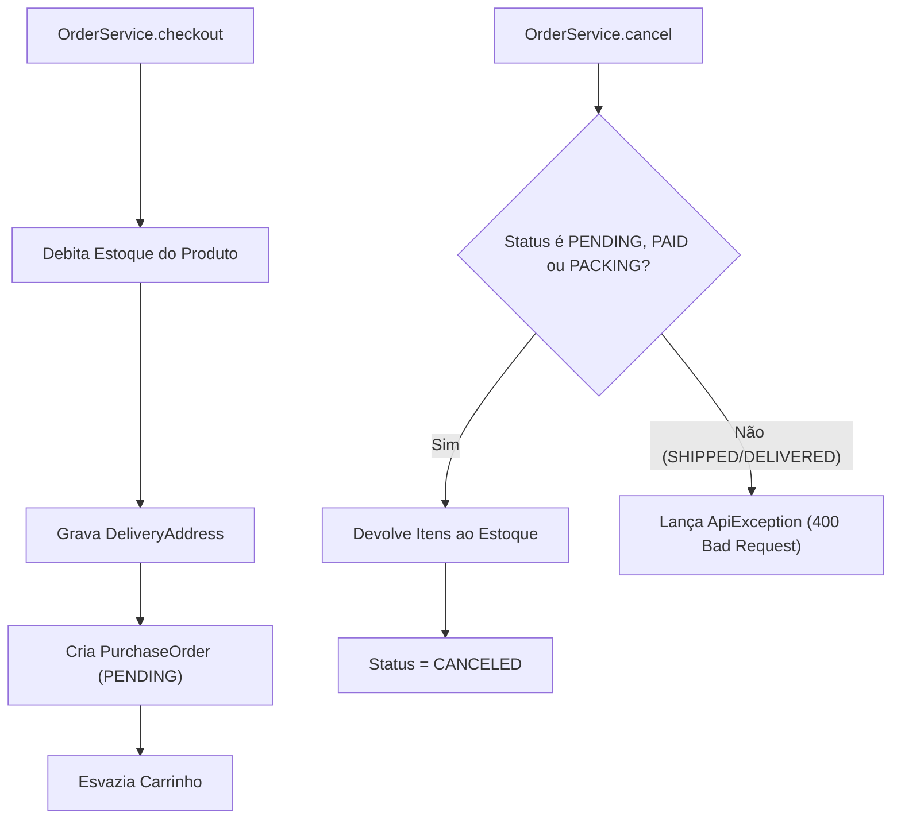

# Módulo: service (`br.com.ecommerce.service`)

## 1. Objetivo do Módulo
Concentrar toda a lógica de negócio, regras de domínio, validações funcionais, transações atômicas de banco de dados, emissão de tokens criptográficos e gerenciamento do ciclo de vida dos pedidos e carrinhos de compras em arquitetura **Single-Tenant**.

---

## 2. Responsabilidade Principal
- Implementar as regras e invariantes de negócio da loja virtual.
- Orquestrar a persistência transacional de checkout com baixa imediata de estoque e composição de endereço de entrega.
- Gerenciar as transições de status da esteira de fulfillment (`PENDING` $\rightarrow$ `PAID` $\rightarrow$ `PACKING` $\rightarrow$ `SHIPPED` $\rightarrow$ `DELIVERED`).
- Aplicar regras de estorno condicional de estoque e proibição de cancelamento parcial.
- Garantir a governança de senhas e perfis de usuários.
- Fornecer exceções customizadas de domínio (`ApiException`) com semântica de status HTTP.

---

## 3. Funcionalidades Existentes e Serviços

### 3.1. `AuthService`
- Validação de unicidade de e-mail no cadastro.
- Hash de senhas com `PasswordEncoder` (BCrypt).
- Autenticação e verificação de credenciais em login.
- Emissão e assinatura de tokens JWT (`accessToken` de 15 minutos e `refreshToken` de 7 dias).

### 3.2. `UserService`
- Consulta e atualização de dados de cadastro (nome, e-mail).
- **Alteração de Senha Segura (`changePassword`)**: Permite ao usuário logado alterar sua senha, validando se a senha atual confere antes de codificar a nova.
- **Exclusão de Conta (`delete`)**: Restrita estritamente ao perfil `ADMIN`. Rejeita qualquer tentativa de auto-exclusão por usuários comuns com `403 Forbidden`.

### 3.3. `CatalogService`
- CRUD de categorias com hierarquia em árvore de profundidade ilimitada (`parent`).
- CRUD de produtos com associação a **múltiplas categorias** (`@ManyToMany`).
- **Filtragem de Produtos Ativos**: Na consulta pública de produtos, produtos com status `INACTIVE` são excluídos imediatamente da resposta.

### 3.4. `CartService`
- Gerenciamento de itens de carrinho associados ao usuário autenticado.
- Validação de status ativo do produto e saldo suficiente de estoque antes da adição.
- Esvaziamento atômico do carrinho após o sucesso do checkout.

### 3.5. `OrderService`
- **Fechamento de Pedido (`@Transactional checkout`)**:
  1. Verifica se o carrinho do usuário contém itens.
  2. Valida disponibilidade de estoque de cada item.
  3. Realiza o decremento imediato do estoque de cada produto (`stock = stock - quantity`).
  4. Cria e persiste a entidade `PurchaseOrder` com status `OrderStatus.PENDING`, contendo a composição imutável de `DeliveryAddress`.
  5. Cria os registros de `OrderItem` com snapshot de preço e quantidade.
  6. Esvazia o carrinho do usuário.
- **Listagem de Pedidos (`list(userId)`)**:
  - Retorna todos os pedidos pertencentes ao usuário autenticado (listagem direta sem paginação/filtros).
  - O administrador não possui rota específica para listar pedidos de um usuário individual.
- **Transição Logística de Status (`updateStatus`)**:
  - Permite exclusivamente ao `ADMIN` avançar o pedido para `PACKING` (em separação) e `SHIPPED` (despachado).
- **Confirmação de Recebimento (`markDelivered`)**:
  - Permite ao cliente (`USER` dono do pedido) ou ao `ADMIN` transicionar o pedido para `DELIVERED`.
- **Cancelamento e Estorno de Estoque (`@Transactional cancel`)**:
  - **Proibição de Cancelamento Parcial**: Cancela sempre o pedido integralmente; itens não podem ser cancelados separadamente.
  - **Condição de Estoque**:
    - Se o pedido estiver em `PENDING`, `PAID` ou `PACKING`: Altera status para `OrderStatus.CANCELED` e **restaura integralmente as quantidades de cada item ao estoque de cada produto**.
    - Se o pedido estiver em `SHIPPED` ou `DELIVERED`: Lança `ApiException(HttpStatus.BAD_REQUEST, "Não é permitido cancelar pedidos já enviados ou entregues")`.

### 3.6. `PaymentService`
- Criação de intenção de pagamento associada a um pedido com status pendente.
- **Confirmação de Pagamento (`confirm`)**:
  - Disparada ativamente pela aplicação front-end com cabeçalho `Idempotency-Key`.
  - Transiciona o pagamento para `PAID` e o pedido associado para `OrderStatus.PAID`.
- **Cancelamento de Pagamento (`cancel`)**:
  - Transiciona o pagamento para `CANCELED` e delega o cancelamento do pedido ao `OrderService`, assegurando o estorno condicional de estoque.

---

## 4. Regras Críticas de Integridade e Transações

---

## 5. Observações Técnicas e Débitos Identificados
- **Persistência de Carrinhos Sem Docker**: Migrar o `ConcurrentHashMap` de `CartService` para tabelas relacionais `carts` e `cart_items` no H2, garantindo durabilidade entre reinicializações sem dependência de Redis.
- **Otimização de Consultas de Catálogo**: Substituir o stream em memória de `CatalogService.products` por paginação e filtros diretamente no banco através de `ProductRepository` com filtro `status = ACTIVE`.
- **Controle Concorrente de Baixa de Estoque**: Adicionar controle de versão `@Version` em `Product` ou bloqueio pessimista `PESSIMISTIC_WRITE` na query do checkout.
